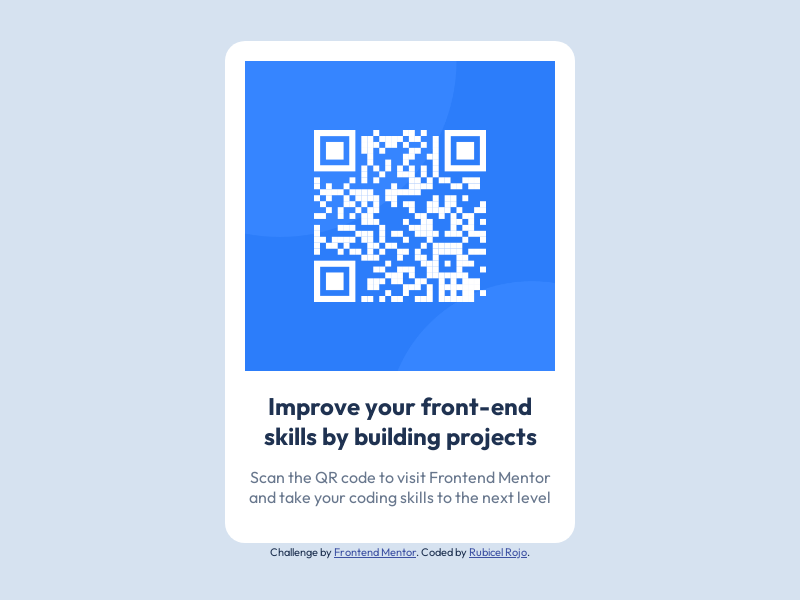

# Frontend Mentor - QR code component solution

This is a solution to the [QR code component challenge on Frontend Mentor](https://www.frontendmentor.io/challenges/qr-code-component-iux_sIO_H). Frontend Mentor challenges help you improve your coding skills by building realistic projects. 

## Table of contents
  - [Screenshot](#screenshot)
  - [Links](#links)
  - [Built with](#built-with)
  - [What I learned](#what-i-learned)
  - [Author](#author)
  - [Acknowledgments](#acknowledgments)

### Screenshot

### Links

- Solution URL: (https://github.com/Rubicelll/fmentor_qr-code-component)
- Live Site URL: (https://rubicelll.github.io/fmentor_qr-code-component/)

### Built with

- Semantic HTML5 markup
- CSS custom properties
- CSS Grid
- Mobile-first workflow

### What I learned

I learned to build web pages using semantic HTML to structure content and CSS to define their visual appearance. I applied a Mobile First approach to create responsive layouts and used BEM (Block, Element, Modifier) to maintain a consistent, organized, and maintainable CSS class naming convention.

## Author

- Instagram - [Rubicel Rojo](https://www.instagram.com/rojo.dev.mx/)
- Frontend Mentor - [@Rubicelll](https://www.frontendmentor.io/profile/Rubicelll)
